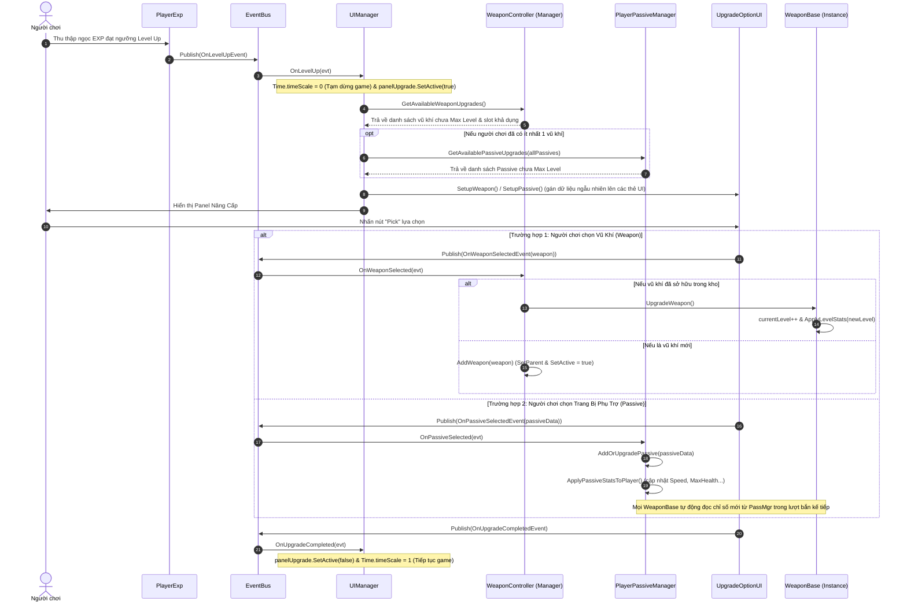
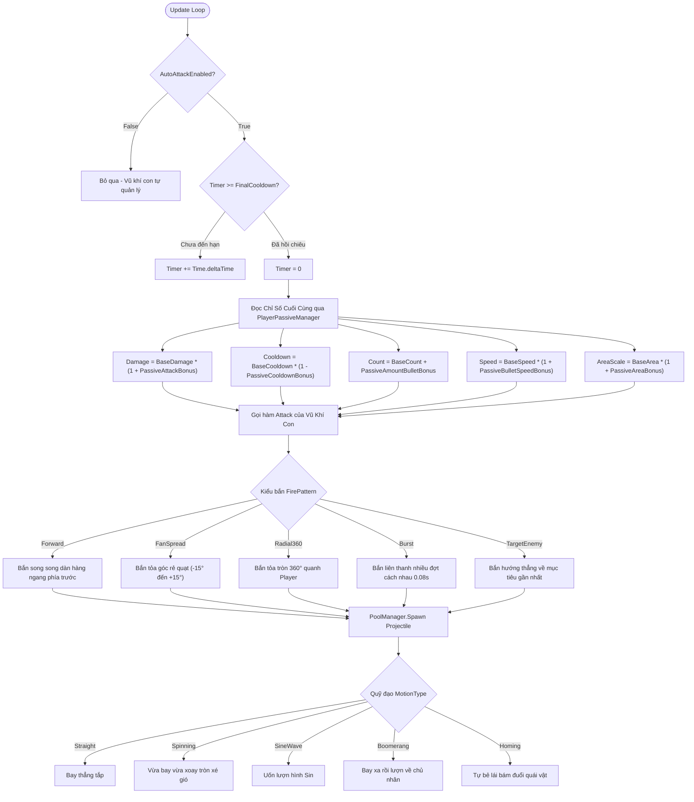

# 🏛️ SƠ ĐỒ THIẾT KẾ KIẾN TRÚC UML (WEAPON & PASSIVE UPGRADE SYSTEM)
**Dự án:** 2D Top-Down Roguelike (Vampire Survivors-like)  
**Ngày cập nhật:** 15/10/2026  
**Kiến trúc:** Tách rời `WeaponBase` (Combat) và `WeaponController` (Inventory Manager), giao tiếp hướng sự kiện qua `EventBus<T>`, `UIManager` thuần view.

---

## 1. 📊 Sơ Đồ Lớp Tổng Thể (Class Diagram)

Sơ đồ thể hiện mối quan hệ giữa 5 phân tầng chính:
1. **Data Layer (ScriptableObjects)**: Cấu hình chỉ số vũ khí, cấp độ, nâng cấp và tiến hóa.
2. **Combat Layer (WeaponBase & Projectiles)**: Vòng lặp bắn đạn, quỹ đạo bay và chỉ số chiến đấu của từng vũ khí riêng biệt.
3. **Inventory & Management Layer (WeaponController & PlayerPassiveManager)**: Quản lý kho trang bị, số lượng slot và trạng thái nâng cấp của người chơi.
4. **EventBus Layer**: Cầu nối decoupled giữa các hệ thống thông qua Generic Event Bus.
5. **Presentation & UI Layer (UIManager & UpgradeOptionUI)**: Hiển thị giao diện, điều khiển pause/resume và kích hoạt sự kiện lựa chọn.

```mermaid
classDiagram
    %% ================= TẦNG EVENT BUS =================
    class IEvent {
        <<interface>>
    }
    class EventBus~T~ {
        +Subscribe(Action~T~ action)$
        +Unsubscribe(Action~T~ action)$
        +Publish(T eventData)$
    }
    class OnLevelUpEvent {
        +int NewLevel
    }
    class OnWeaponSelectedEvent {
        +GameObject Weapon
    }
    class OnPassiveSelectedEvent {
        +PassiveItemData Passive
    }
    class OnUpgradeCompletedEvent
    class OnHealthChangedEvent {
        +int CurrentHealth
        +int MaxHealth
    }
    class OnExpChangedEvent {
        +int CurrentExp
        +int ExpToLevelUp
    }

    IEvent <|.. OnLevelUpEvent
    IEvent <|.. OnWeaponSelectedEvent
    IEvent <|.. OnPassiveSelectedEvent
    IEvent <|.. OnUpgradeCompletedEvent
    IEvent <|.. OnHealthChangedEvent
    IEvent <|.. OnExpChangedEvent
    EventBus ..> IEvent : Quản lý và dispatch

    %% ================= TẦNG DATA (SCRIPTABLE OBJECTS) =================
    class WeaponData {
        +string weaponName
        +Sprite icon
        +string projectileKey
        +int damage
        +float cooldown
        +float projectileSpeed
        +List~WeaponLevelData~ levels
        +bool isEvolution
        +WeaponEvolutionData evolutionData
        +GetLevelData(int level) WeaponLevelData
        +GetUpgradeDescription(int level) string
    }

    class WeaponLevelData {
        +int damage
        +float cooldown
        +float projectileSpeed
        +int projectileCount
        +float areaScale
        +float duration
        +FirePattern firePattern
        +ProjectileMotionType motionType
        +float spreadAngle
        +float spinSpeed
        +float waveFrequency
        +float waveAmplitude
        +string upgradeDescription
    }

    class WeaponEvolutionData {
        +WeaponData baseWeapon
        +PassiveItemData requiredPassive
        +int requiredWeaponLevel
        +WeaponData evolvedWeapon
        +GameObject evolvedWeaponPrefab
        +CanEvolve(int wLevel, int pLevel) bool
    }

    class PassiveItemData {
        +string passiveName
        +Sprite icon
        +string baseDescription
        +PassiveStatType statType
        +List~PassiveLevelData~ levels
        +GetLevelData(int level) PassiveLevelData
        +GetUpgradeDescription(int level) string
    }

    class PassiveLevelData {
        +float Value
        +string upgradeDescription
    }

    WeaponData *-- WeaponLevelData : Chứa danh sách (Composition)
    WeaponData o-- WeaponEvolutionData : Liên kết tiến hóa
    WeaponEvolutionData o-- WeaponData : Vũ khí gốc & Sau tiến hóa
    WeaponEvolutionData o-- PassiveItemData : Passive yêu cầu
    PassiveItemData *-- PassiveLevelData : Chứa danh sách

    %% ================= TẦNG COMBAT (WEAPON BASE & PROJECTILES) =================
    class WeaponBase {
        <<abstract>>
        +WeaponData weaponData
        +Transform spawnHolder
        +int currentLevel
        +int currentDamage
        +float currentSpeed
        +float currentCooldown
        +int currentProjectileCount
        +float currentAreaScale
        +FirePattern currentFirePattern
        +ProjectileMotionType currentMotionType
        +ApplyLevelStats(int level)
        +UpgradeWeapon()
        +GetFinalDamage() int
        +GetFinalCooldown() float
        +GetFinalSpeed() float
        +GetFinalProjectileCount() int
        +GetFinalAreaScale() float
        #ExecuteFirePattern(Vector2 dir, Transform target)
        #SpawnSingleProjectile(Vector2 pos, Vector2 dir, Transform target)
        #Attack()*
    }

    class KnifeWeaponController {
        #Attack()
    }
    class AxeWeaponController {
        #Attack()
    }
    class MagicOrbWeapon {
        #Attack()
    }
    class WhipController {
        #Attack()
    }
    class LightningController {
        #Attack()
    }
    class ShieldWeaponController {
        #Attack()
    }

    WeaponBase <|-- KnifeWeaponController : Kế thừa
    WeaponBase <|-- AxeWeaponController : Kế thừa
    WeaponBase <|-- MagicOrbWeapon : Kế thừa
    WeaponBase <|-- WhipController : Kế thừa
    WeaponBase <|-- LightningController : Kế thừa
    WeaponBase <|-- ShieldWeaponController : Kế thừa
    WeaponBase o-- WeaponData : Tham chiếu Data

    class Projectile {
        -ProjectileMotionType motionType
        -float speed
        -int damage
        +InitializeAdvanced(...)
        -UpdateMotion()
        -HandleDamage(GameObject target)
        -DespawnSelf()
    }

    WeaponBase ..> Projectile : Spawn đạn từ Pool

    %% ================= TẦNG INVENTORY & QUẢN LÝ (MANAGERS) =================
    class WeaponController {
        <<Singleton>>
        +WeaponController Instance$
        -GameObject weaponHolder
        -int maxWeapon
        -List~GameObject~ allWeapons
        -List~GameObject~ currentWeapons
        +LoadCurrentWeapon()
        +HasWeapon(GameObject weapon) bool
        +CanAddWeapon() bool
        +IsWeaponMaxLevel(GameObject weapon) bool
        +AddWeapon(GameObject weapon)
        +UpgradeWeapon(GameObject weapon)
        +GetAvailableWeaponUpgrades() List~GameObject~
        -OnWeaponSelected(OnWeaponSelectedEvent evt)
    }

    class PlayerPassiveManager {
        <<Singleton>>
        +PlayerPassiveManager Instance$
        -int maxPassiveSlots
        -List~PassiveSlot~ ownedPassives
        +GetBonus(PassiveStatType statType) float
        +AddOrUpgradePassive(PassiveItemData passive)
        +HasPassive(PassiveItemData passive) bool
        +IsMaxLevel(PassiveItemData passive) bool
        +CanAddPassive() bool
        +GetAvailablePassiveUpgrades(List~PassiveItemData~ allPassives) List~PassiveItemData~
        +ApplyPassiveStatsToPlayer()
        -OnPassiveSelected(OnPassiveSelectedEvent evt)
    }

    class PassiveSlot {
        +PassiveItemData data
        +int currentLevel
        +IsMaxLevel bool
    }

    PlayerPassiveManager *-- PassiveSlot : Quản lý slot
    PassiveSlot o-- PassiveItemData : Tham chiếu Data
    WeaponController o-- WeaponBase : Quản lý thực thể vũ khí
    WeaponBase ..> PlayerPassiveManager : Đọc Bonus chỉ số toàn cục

    %% ================= TẦNG PLAYER =================
    class Player {
        -int Health
        -int MaxHealth
        +TakeDamage(int dame)
        +Heal(int amount)
        +UpdateMaxHealthBonus(float bonus)
    }

    class PlayerController {
        -float MoveSpeed
        +UpdateMoveSpeedBonus(float bonus)
    }

    PlayerPassiveManager --> Player : Scale Máu / Hồi máu
    PlayerPassiveManager --> PlayerController : Scale Tốc độ chạy

    %% ================= TẦNG GIAO DIỆN & NÂNG CẤP (UI) =================
    class UIManager {
        <<Singleton>>
        +UIManager instance$
        -List~PassiveItemData~ allPassives
        -GameObject panelUpgrade
        -GameObject panelPause
        -GameObject panelGameOver
        +TogglePause()
        -Upgrade()
        -OnLevelUp(OnLevelUpEvent evt)
        -OnUpgradeCompleted(OnUpgradeCompletedEvent evt)
    }

    class UpgradeOptionUI {
        -Image weaponImage
        -Button pickButton
        -TextMeshProUGUI textName
        -TextMeshProUGUI textLevel
        -TextMeshProUGUI textDescription
        -GameObject weapon
        -PassiveItemData passiveData
        +SetupWeapon(GameObject weaponObj)
        +SetupPassive(PassiveItemData passive)
        -Pick()
    }

    UIManager o-- UpgradeOptionUI : Điều khiển hiển thị thẻ nâng cấp
    UIManager ..> WeaponController : Lấy danh sách vũ khí khả dụng
    UIManager ..> PlayerPassiveManager : Lấy danh sách passive khả dụng

    %% TƯƠNG TÁC SỰ KIỆN QUA EVENTBUS
    WeaponController ..> EventBus : Lắng nghe OnWeaponSelectedEvent
    PlayerPassiveManager ..> EventBus : Lắng nghe OnPassiveSelectedEvent
    UIManager ..> EventBus : Lắng nghe OnLevelUpEvent & OnUpgradeCompletedEvent
    UpgradeOptionUI ..> EventBus : Publish OnWeaponSelected / OnPassiveSelected & OnUpgradeCompleted
```

---

## 2. ⏱️ Sơ Đồ Trình Tự Nâng Cấp Hoàn Toàn Decoupled (Sequence Diagram)

Mô tả luồng giao tiếp 100% qua **EventBus**, tách biệt giữa UI, kho vũ khí và trang bị phụ trợ:

---

## 3. 🔄 Sơ Đồ Vòng Đời Tấn Công & Quỹ Đạo Đạn Trong `WeaponBase` (Combat Flow)

Mô tả cơ chế vòng lặp tấn công tự động của `WeaponBase`, tự động áp dụng hệ số từ `PlayerPassiveManager` và điều phối dạng bắn / quỹ đạo đạn:

---

## 4. 📋 Tóm Tắt Trách Nhiệm Từng Thành Phần (SOLID & Clean Architecture)

| Lớp | Loại | Trách nhiệm chính |
| :--- | :--- | :--- |
| **`WeaponBase`** | Abstract Class | Lớp cha của mọi vũ khí con. Quản lý timer tấn công, level, fire pattern, motion type và tự động tích hợp bonus từ passive. |
| **`WeaponController`** | Manager / Singleton | Quản lý kho vũ khí người chơi (`currentWeapons`, `maxWeapon`, `weaponHolder`). Xử lý thêm mới/nâng cấp vũ khí khi nhận `OnWeaponSelectedEvent`. |
| **`PlayerPassiveManager`** | Manager / Singleton | Quản lý kho passive slots (`ownedPassives`). Cung cấp API tính tổng bonus theo loại chỉ số (`GetBonus`). Lắng nghe `OnPassiveSelectedEvent`. |
| **`UpgradeOptionUI`** | View / Component | Hiển thị thông tin icon, tên, cấp độ, mô tả nâng cấp. Khi click phát `OnWeaponSelectedEvent`/`OnPassiveSelectedEvent` và `OnUpgradeCompletedEvent`. |
| **`UIManager`** | View Controller / Singleton | Quản lý HUD (máu, exp), Panel Pause, Game Over và Panel Upgrade. Điều khiển TimeScale khi dừng/tiếp tục game. |
| **`EventBus<T>`** | Infrastructure / Core | Generic static event bus giúp các hệ thống phát và nhận sự kiện mà không cần tham chiếu trực tiếp đến nhau. |
