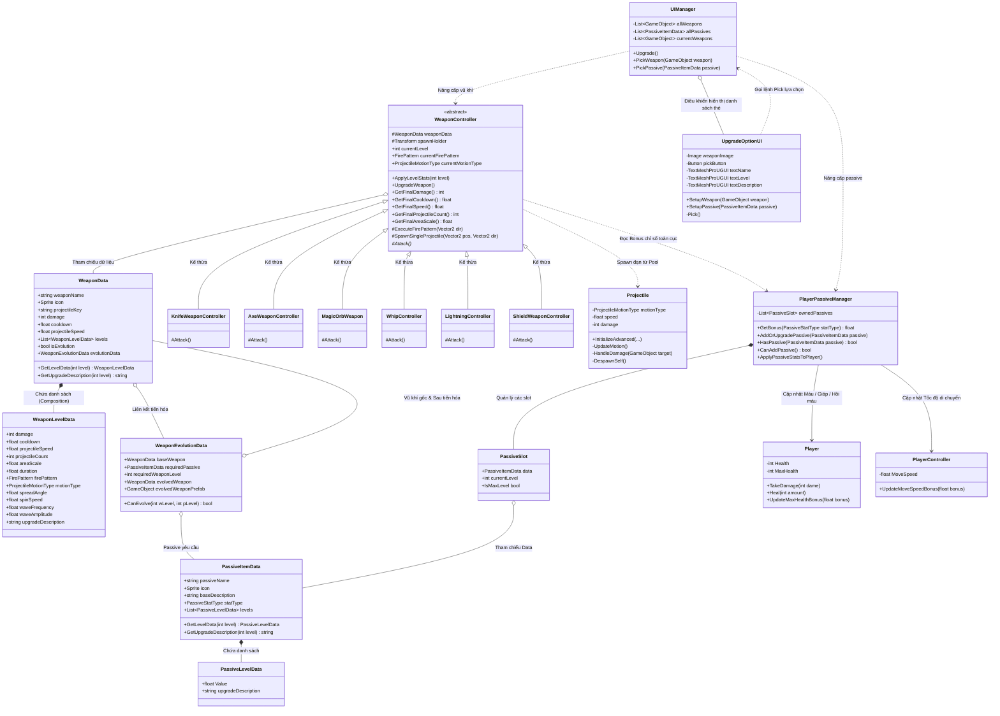
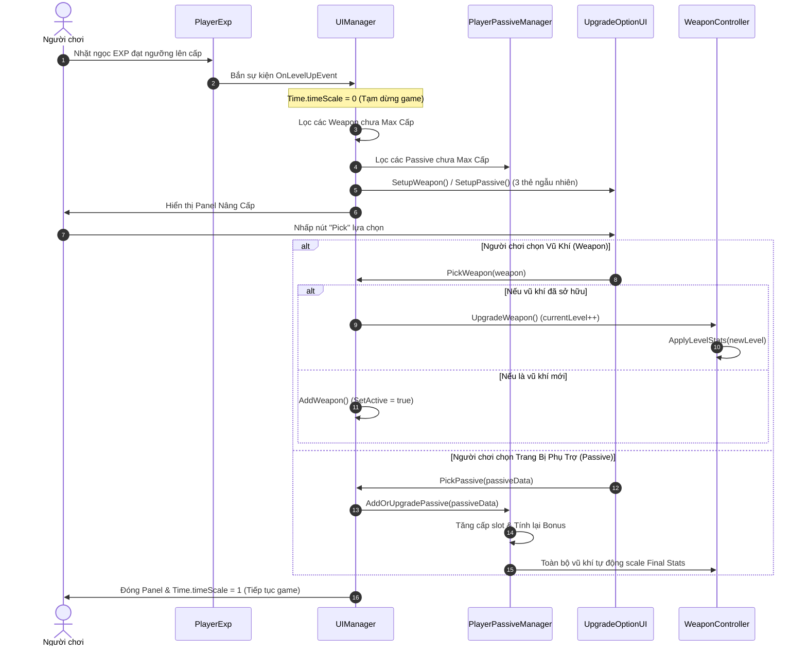
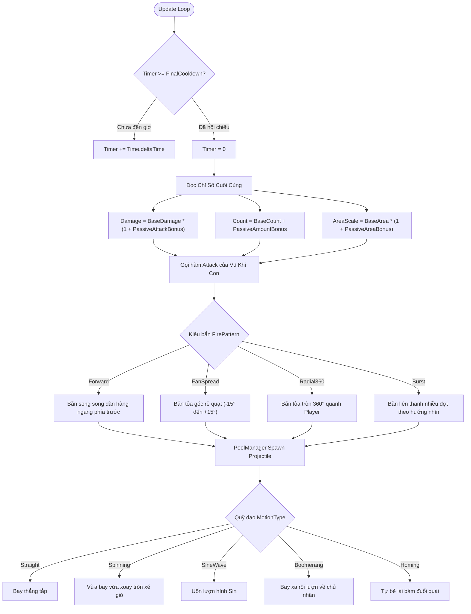

# 🏛️ SƠ ĐỒ THIẾT KẾ KIẾN TRÚC UML (WEAPON & PASSIVE UPGRADE SYSTEM)
**Dự án:** 2D Top-Down Roguelike (Vampire Survivors-like)  
**Ngày cập nhật:** 14/10/2026  

Tài liệu này cung cấp các sơ đồ UML chi tiết (Class Diagram, Sequence Diagram, Activity Diagram) mô tả toàn bộ cấu trúc hệ thống Vũ khí (Weapons), Trang bị phụ trợ (Passive Items), Quỹ đạo bay (Trajectories) và Vòng lặp Nâng cấp (Level Up Loop).

---

## 1. 📊 Sơ Đồ Lớp Tổng Thể (Class Diagram)

Sơ đồ thể hiện mối quan hệ giữa 4 tầng chính: **Data Layer (ScriptableObjects)**, **Combat Layer (Weapons & Projectiles)**, **Player & Passive Layer**, và **UI Layer (Level Up System)**.

---

## 2. ⏱️ Sơ Đồ Trình Tự Bốc Thưởng Khi Lên Cấp (Sequence Diagram)

Mô tả luồng tương tác giữa Người chơi, EventBus, UIManager, PlayerPassiveManager và WeaponController:

---

## 3. 🔄 Sơ Đồ Vòng Đời Tấn Công & Quỹ Đạo Đạn (Combat & Trajectory Flow)

