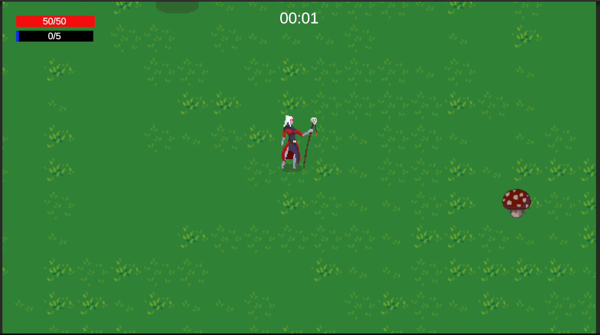
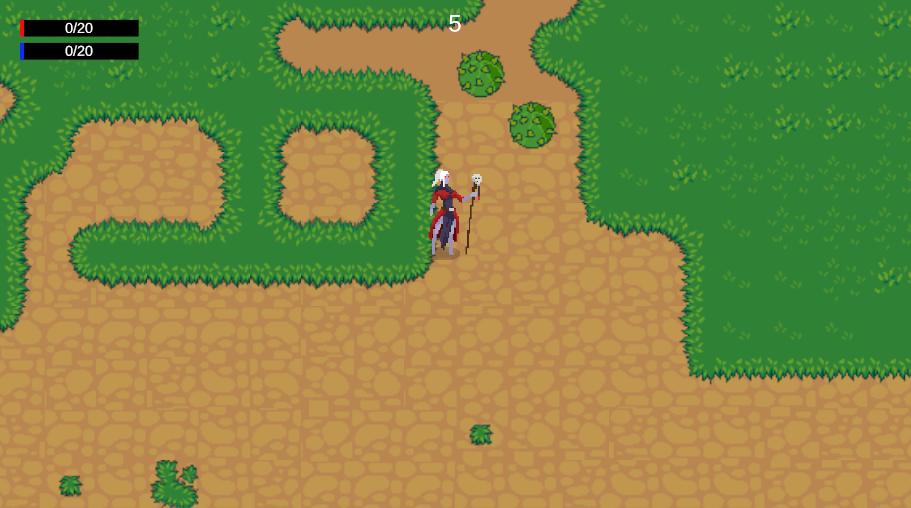
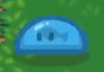
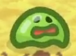
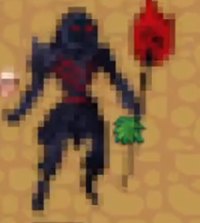
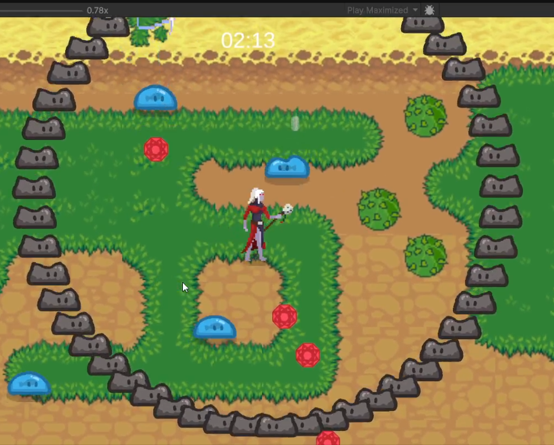
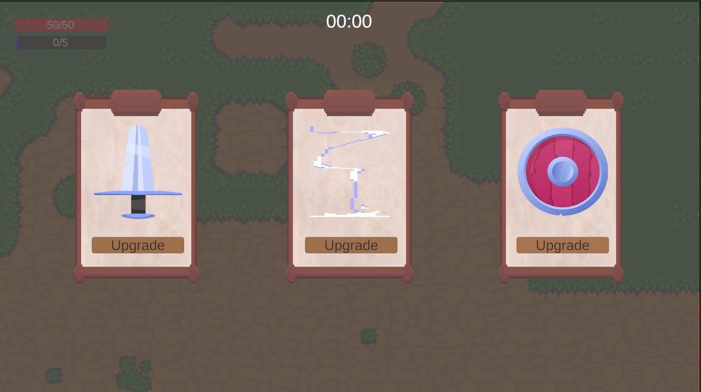

# 🎮 2D Survival Game (Unity)

Một tựa **game 2D top-down survival** lấy cảm hứng từ dòng game *Vampire Survivors*, nơi người chơi phải sinh tồn trước làn sóng quái vật ngày càng mạnh, nâng cấp kỹ năng – vũ khí và đối đầu với **Boss** trong các bản đồ khác nhau.

---

## 🧩 Tổng quan gameplay

* Điều khiển nhân vật di chuyển tự do trong bản đồ 2D
* Tiêu diệt quái vật theo **wave (đợt)**
* Nhận EXP, nâng cấp vũ khí & kỹ năng thông qua **Upgrade UI**
* Xuất hiện **Event đặc biệt** trong quá trình chơi
* Đối đầu **Boss** với các pattern tấn công riêng

---

## 🗺️ Bản đồ (Maps)

### 🌍 Open World Map

Bản đồ mở cho phép người chơi di chuyển tự do, quái xuất hiện liên tục theo thời gian.

---

### ⚔️ Arena Map

Bản đồ dạng đấu trường, tập trung vào giao tranh cường độ cao và Boss.

---

## 👾 Quái vật (Enemies)

Game hiện có nhiều loại quái với hành vi khác nhau.

### 🟢 Slime – Loại 1

Quái cơ bản, số lượng đông, áp sát người chơi.

---

### 🔵 Slime – Loại 2

Phiên bản nâng cấp: bắn tầm xa/ nguy hiểm hơn.

---

## 👑 Boss

Boss xuất hiện ở các mốc quan trọng, có **AI riêng**, nhiều state (Idle / Dash / Skill).

---

## 🌊 Event & Wave System

Hệ thống **Wave** và **Event đặc biệt** giúp tăng độ thử thách và nhịp độ trận đấu.

---

## ⬆️ Hệ thống nâng cấp (Upgrade System)

Sau mỗi mốc hoặc khi đạt đủ EXP, người chơi có thể chọn nâng cấp:

* Vũ khí
* Chỉ số nhân vật
* Kỹ năng đặc biệt

* Hiện tại đã và đang triển khai 6 loại vũ khí
---

## 🛠️ Công nghệ sử dụng

* **Unity 2D**
* **C# (OOP, FSM cho Enemy/Boss)**
* Object Pooling (tối ưu hiệu năng)
* AI di chuyển & tấn công theo state

---

## 🚀 Hướng phát triển tiếp theo

* Thêm nhiều loại quái & Boss phase
* Thêm vũ khí và skill mới
* Nâng cấp hệ thống Event
* Lưu / tải tiến trình chơi

---

## 📽️ Demo

*(Sẽ cập nhật video gameplay demo sau)*

---

## 👤 Tác giả

* **Unity Developer**
* Dự án cá nhân phục vụ học tập & phát triển kỹ năng làm game 2D

---

> 💡 *Dự án đang trong quá trình phát triển, mọi góp ý đều được hoan nghênh!*
